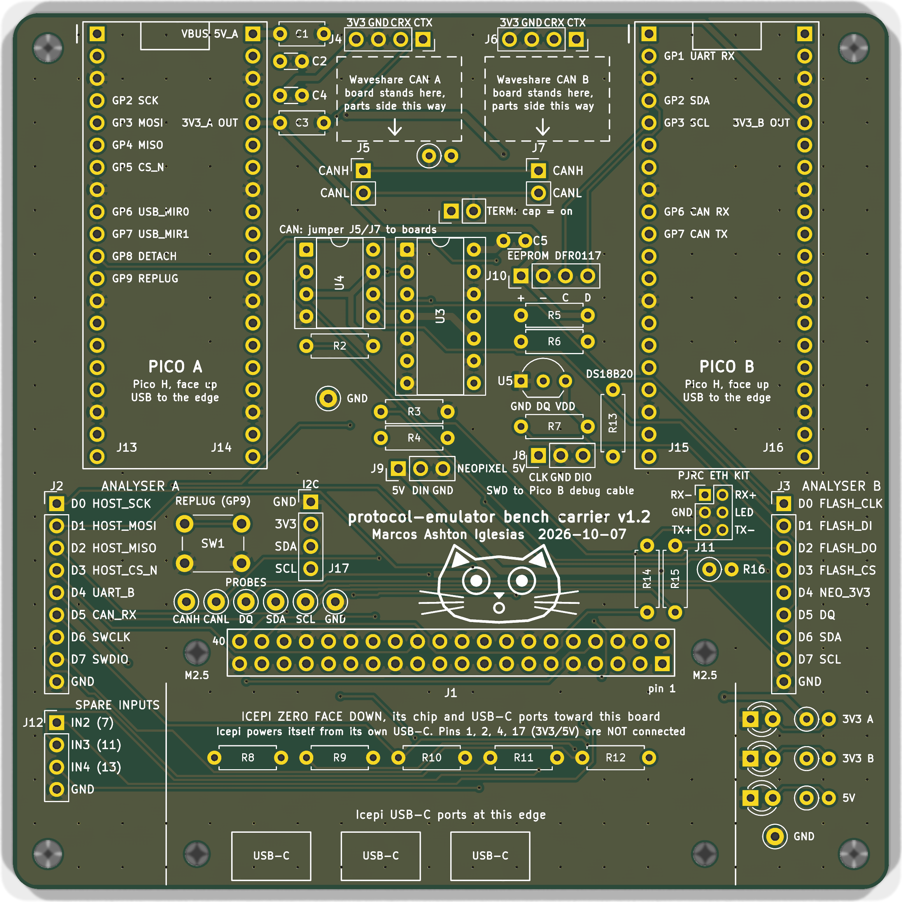

# protocol-emulator bench

The carrier board for the [protocol-emulator](https://github.com/MarcosAsh/protocol-emulator) demo bench.
An Icepi Zero (ECP5) plays the chip and two Raspberry Pi Picos drive and check it. The board wires
them to every outside part the demos use: two CAN transceivers, an I2C EEPROM, a DS18B20, SPI flash,
a NeoPixel stick, SWD into the second Pico, 10BASE-T and two logic analysers.

v1.2, 100 x 100 mm, two layers, all through-hole, 47 nets, DRC clean. JLCPCB made and assembled it in
October 2026. The main repo's `demo/carrier_check.sh` tests every net it can reach on an assembled
board.

## Files

| Path | What |
|---|---|
| `carrier/gen.py` | builds the whole board from its parts and nets tables, then routes, checks and plots it |
| `carrier/carrier.kicad_pcb` | the board, KiCad 9 |
| `carrier/netlist.csv`, `carrier/bom.csv` | nets by pad, and the parts list with what you plug in yourself |
| `carrier/carrier_jlcpcb_gerbers.zip` | gerbers and drills, as ordered |
| `carrier/jlcpcb/` | JLC assembly BOM and placement files as ordered, and the note on what you fit after delivery |
| `carrier/renders/` | top and bottom renders and each layer |

## Ordering one

Upload `carrier_jlcpcb_gerbers.zip` to JLCPCB, then `jlcpcb/jlc_bom.csv` and `jlcpcb/jlc_cpl.csv` for
through-hole assembly. Check pin 1 of J1, J13-J16, U3, U4 and U5 in their placement preview.
`jlcpcb/assembly_note.txt` lists the boards and parts that plug in afterwards.

## Rebuilding

Needs KiCad 9 and its Python module on Linux. From `carrier/`, `python3 gen.py` rebuilds everything and
keeps the saved routing while placement and nets are unchanged. `python3 gen.py --reroute` routes again
with Freerouting, which it expects at `tools/freerouting.jar`.

## Licence

CERN-OHL-P v2, see `LICENSE`.
